

# Autocomplete+++

**ComfyUI 中文提示词助手**

标签补全 · 模型与触发词 · 动态提示词 · 通配符 · 提示词编辑

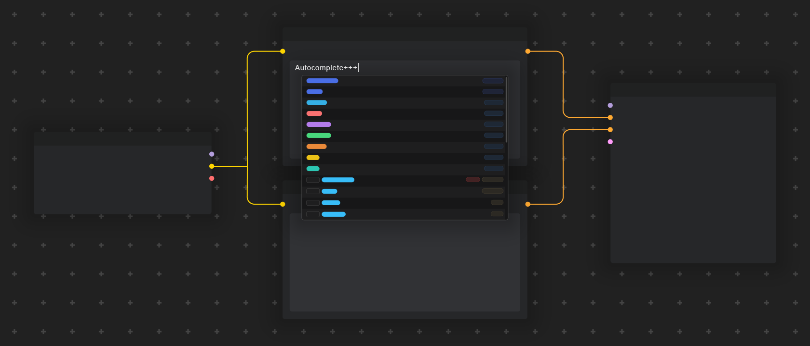

[快速开始](#快速开始) · [功能介绍](#功能介绍) · [使用指南](README_zh.md) · [常见问题](#常见问题)

Autocomplete+++ 在 ComfyUI 的提示词输入框中提供标签搜索、中文名称、LoRA / Embedding 补全，以及提示词展开和编辑工具。支持经典 LiteGraph 与 Node 2.0。

项目基于 [Autocomplete++](https://github.com/michikora/ComfyUI-Autocomplete-Plus-Plus) 改造，在原有功能上加入中文 UI、双排序、完整分页、类别筛选、可调补全布局和本地关联标签。默认使用 `danbooru_merged_zh.csv`，包含 **296,884 个去重标签**，Danbooru 词库截止至 **2026.10.12**。

## 快速开始

### 安装

#### 通过 ComfyUI-Manager 安装

> **首次发布状态：** `v1.0.0` 已提交至 [Comfy Registry](https://registry.comfy.org/zh/publishers/twinklestar/nodes/comfyui-autocomplete-plus-plus-plus)，目前等待平台检查。检查通过并同步 Manager 索引后，可按以下步骤安装；暂时搜不到时，请使用下方的 ZIP 安装方式。

1. 打开 **Manager → Custom Nodes Manager（安装自定义节点）**。
2. 搜索 `Autocomplete+++`，也可尝试完整名称 `comfyui-autocomplete-plus-plus-plus`。
3. 核对项目名称为 **Autocomplete+++**、发布者为 **twinklestar**，点击 **Install（安装）**。
4. 安装完成后重启 ComfyUI，再按 `Ctrl + F5` 刷新浏览器。

#### 手动安装 ZIP

1. 从 [Releases](https://github.com/TwinkleStarDust/comfyui-autocomplete-plus-plus-plus/releases/latest) 下载 `comfyui-autocomplete-plus-plus-plus-v1.0.0.zip`，解压到 `ComfyUI/custom_nodes/comfyui-autocomplete-plus-plus-plus/`。
2. 确认该目录下直接包含 `__init__.py`，重启 ComfyUI 后端，再按 `Ctrl + F5` 刷新浏览器。

安装后，将 ComfyUI 语言设为中文，在设置中搜索 `Autocomplete+++`。

插件使用 ComfyUI 现有 Python 环境，没有额外声明的 Python 依赖。LoRA Manager 为可选集成。

从 Autocomplete++ 或已有安装升级

备份自定义词库、通配符和 `data/user_data.json`，再更新插件文件。原目录名为 `comfyui-autocomplete-plus-plus` 时，可改为 `comfyui-autocomplete-plus-plus-plus`。

仅保留一个生效版本，避免重复注册节点与接口。内部设置 ID、节点类型和本地 API 标识保持兼容，已有设置、常用记录及工作流可以继续使用。

ComfyUI-Manager 中的 `Autocomplete++` 条目对应原项目。本项目请选择 **Autocomplete+++（发布者：twinklestar）**；索引尚未同步时，可使用上方的 ZIP 安装方式。

### 启用中文词库

| 设置 | 推荐值 |
| --- | --- |
| 主标签文件 | `danbooru_merged_zh.csv` |
| 标签翻译文件 | `无`，使用主词库内嵌译名 |
| 按翻译 / 中文名称搜索 | 开启 |
| 在补全候选中显示翻译 | 开启 |

默认主词库为 `danbooru_merged_zh.csv`，已内嵌中文译名。已有安装若保留了其他词库设置，可在此切换；工作流中若有「词典控制器」，将其设为跟随全局，或选择相同文件。

配置后可以输入 `long hair`、`长发` 或 `yui` 试用补全。选中候选后，按 `Enter` / `Tab` 插入对应英文标签。

## 功能介绍

以下均为 **Autocomplete+++ 在本地 ComfyUI 中的实际界面**。对比图由真实截图裁剪、拼接，图外标题用于说明操作。为展示分页，部分截图将每页候选数设为 8；模型名称、候选数量和译名取决于本地文件与词库。

| 查找与选择 | 模型与展开 | 编辑与配置 |
| --- | --- | --- |
| [中文与别名搜索](#标签补全与中文搜索) | [LoRA / Embedding](#lora-与-embedding-补全) | [权重、换位与整理](#提示词编辑与自动整理) |
| [排序、类别与分页](#排序筛选与完整分页) | [触发词与模型详情](#触发词预设与模型详情) | [常用标签](#常用标签与个人记录) |
| [窗口与翻译布局](#窗口宽度与翻译布局) | [Anima 画师](#anima-画师补全) | [工作流控制器](#四种工作流控制器) |
| [本地关联标签](#本地关联标签) | [动态提示词](#动态提示词与实际展开) | [节点菜单与兼容](#节点菜单与画布兼容) |
| [通配符文件与行浏览](#通配符文件与逐行浏览) | [展开模式与 PNG 恢复](#展开模式与-png-恢复) | [中文设置与词库](#中文设置与词库组合) |

### 标签补全与中文搜索

支持搜索 Danbooru / e621 标签、别名和译名。输入英文原名或中文名称，选中后按 `Enter` / `Tab` 插入英文标签；候选同时显示译名、投稿数和词库来源。点击「百科」或按 `F1` 可查阅标签 Wiki。

**输入「平沢唯」，直接找到 `hirasawa_yui`。** 原有译名与别名 `平沢唯,ゆいあず,yuihirasawa` 保留在同一词条中。

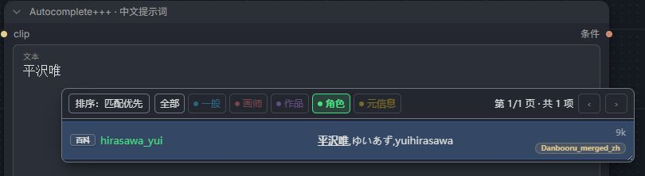

除了点击类别按钮，也可输入 `/character yui`、`/artist artist_name` 或 `/danbooru /artist artist_name` 限定搜索范围。[查看搜索语法](README_zh.md#限定搜索范围)。

### 排序、筛选与完整分页

弹窗左上角可随时切换两种排序。下面使用相同的 `yui` 查询和「角色」筛选，对比首屏结果：

- **投稿数优先**：完全匹配优先，其余按词库投稿数降序排列，`hirasawa_yui` 等常见角色更容易找到。
- **匹配优先**：综合原名、译名与别名的匹配程度排列，前缀匹配通常更靠前。

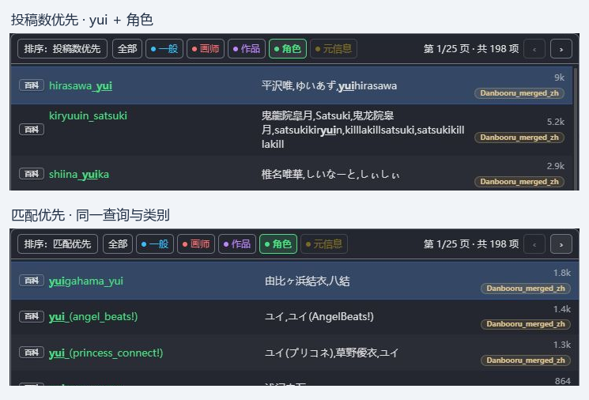

类别按钮同时提供筛选和颜色图例。点击「角色」「作品」等缩小范围，再点当前类别或「全部」取消筛选。

类别颜色代表什么？

| 颜色 | 类别 | 常见内容 |
| --- | --- | --- |
| 蓝色 | 一般 | 发色、服装、动作、构图 |
| 红色 | 画师 | 画师、创作者 |
| 紫色 | 作品 | 动画、游戏、系列 |
| 绿色 | 角色 | 角色名称 |
| 黄色 | 元信息 | 图片和制作方式等元数据 |

这组含义对应 Danbooru。e621 还包含物种、设定和无效标签，详见[类别说明](README_zh.md#类别与颜色)。

**每页 5–50 项，全部结果均可翻页浏览。** 按钮和 `PageUp` / `PageDown` 切换整页，上下方向键也可跨页；单页数量不会截断总结果。

查看第 2 页：198 个角色结果分为 25 页

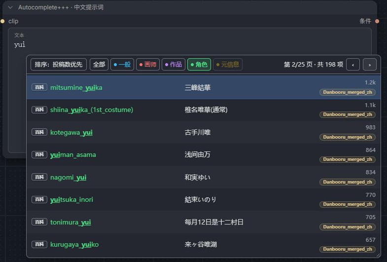

翻页、排序和筛选复用当前结果，只绘制当前页，不重新读取 CSV 或重做全词库搜索。新查询的耗时仍取决于词库大小与设备。

### 窗口宽度与翻译布局

原名与译名支持 **左右分栏、行内显示、上下排列**。长译名可以自动换行，设置页提供随选项更新的显示预览。

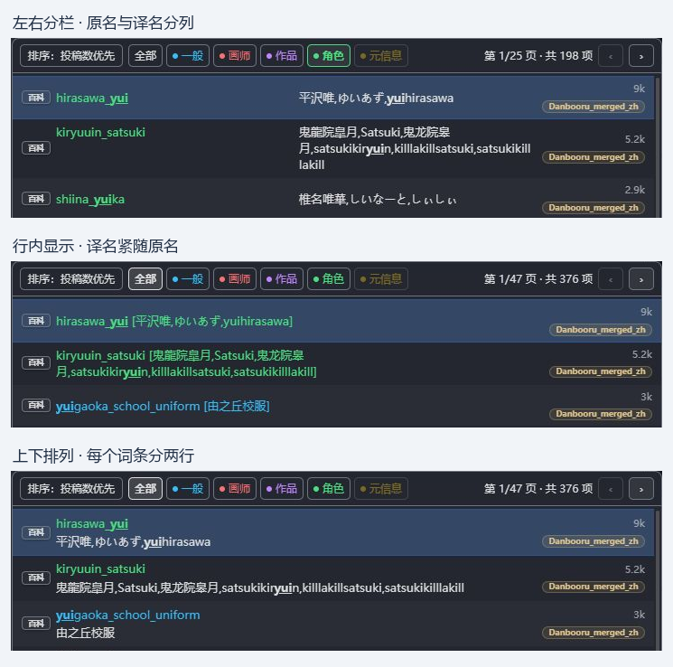

窗口可在设置中调整为 280–1600 px，也可拖动右下角调宽并保存，实际宽度不超过可用视口。关闭换行后，可悬停查看被截断的文字。

### LoRA 与 Embedding 补全

输入 `<lora:` 查找本地 LoRA，输入 `embedding:` 或 `emb:` 查找 Embedding。选择模型时可显示本地缩略图；预览卡片位置和动画播放方式均可配置。

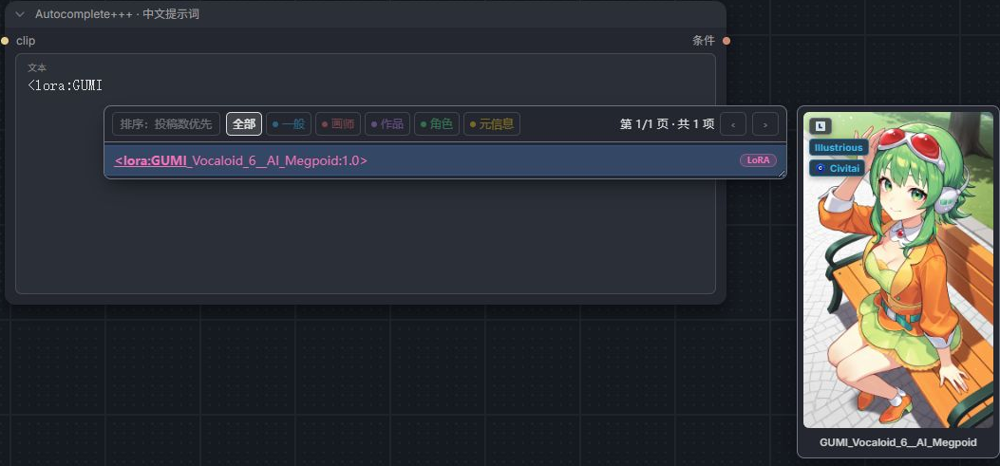

查看 LoRA 子目录与 Embedding 列表

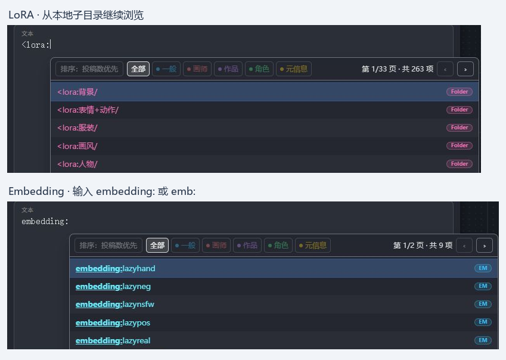

LoRA 支持「自动」「仅文件名」「完整路径」三种路径补全方式。自动模式会在遇到重名模型时使用相对路径。[模型与路径说明](README_zh.md#lora-与-embedding)。

### 触发词、预设与模型详情

安装并启用可选的 [ComfyUI-Lora-Manager](https://github.com/willmiao/ComfyUI-Lora-Manager) 后，输入 `<trigger:` 可检索 **当前工作流已加载 LoRA** 的触发词。预览中可逐项选择，也可点击「插入整组」使用完整提示词预设。

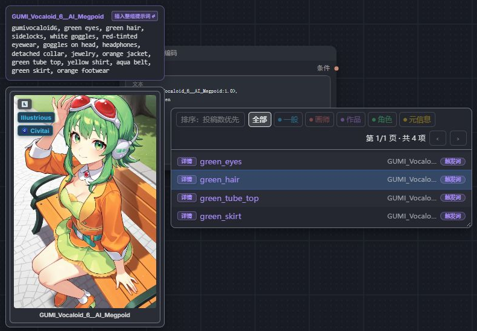

查看中文模型详情、推荐参数与图库

选中触发词后按 `F1` 或点击信息按钮，可查看模型信息、推荐强度、CLIP 参数、触发词、预设和图库。触发词与预设支持复制，图片支持查看可用的生成参数；底部可跳转到 LoRA Manager。

具体内容取决于 LoRA Manager 版本和模型已有元数据。多个模型共用触发词时，会先显示模型选择菜单。[集成说明](README_zh.md#lora-manager-集成)。

### Anima 画师补全

Anima 模式生效时，输入 `@` 可搜索画师；从普通标签搜索选择画师，也会自动添加 `@` 前缀。

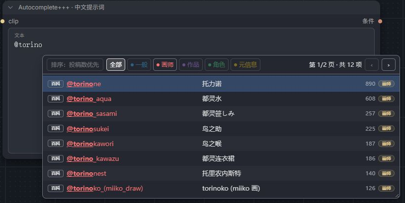

默认自动检测工作流模型，也可在「Anima 艺术家前缀模式」中强制启用或关闭。图中演示的是启用模式后的 `@torino` 查询。

### 动态提示词与实际展开

在文本中写入备选项，展开引擎会在运行前按所选模式解析。支持随机选择、权重、多项抽取和自定义分隔符：

| 写法 | 作用 |
| --- | --- |
| `{red hair \| blue hair \| green hair}` | 抽取一个选项 |
| `{3::sunny \| 1::rainy}` | 按 3:1 的权重抽取 |
| `{2$$red ribbons \| blue ribbons \| green hairband}` | 抽取两个不同选项 |
| `{1-3$$ and $$apples \| bananas \| oranges}` | 抽取 1–3 项，用 ` and ` 连接 |

下图上方为输入，下方为 **同次实际运行的展开结果**；最后一行同时演示了从通配符文件取出 `forest`。

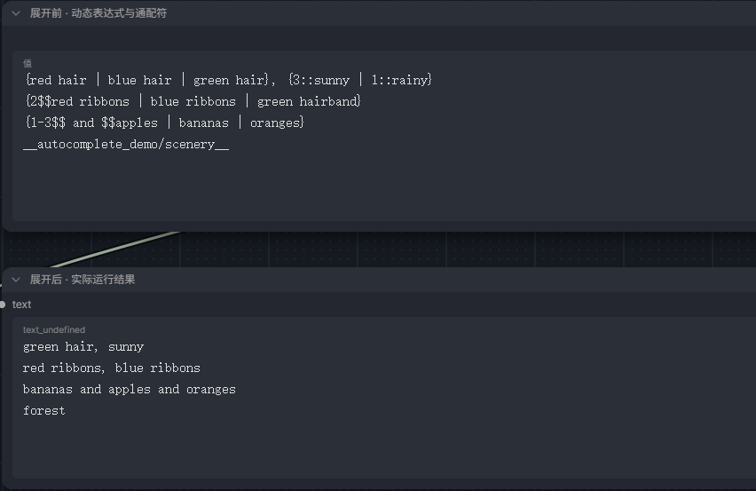

截图使用 Text (Multiline) 与 Show Text 🐍 节点查看文本结果，后者是演示环境中的辅助节点，不是本插件新增节点。[完整语法](README_zh.md#动态提示词与通配符)。

### 通配符文件与逐行浏览

输入 `__` 浏览通配符文件与目录。文件名后追加 `/`，例如 `__autocomplete_demo/scenery/`，可直接查看其中每一行；选择完整的 `__autocomplete_demo/scenery__` 则保留为运行时抽取。

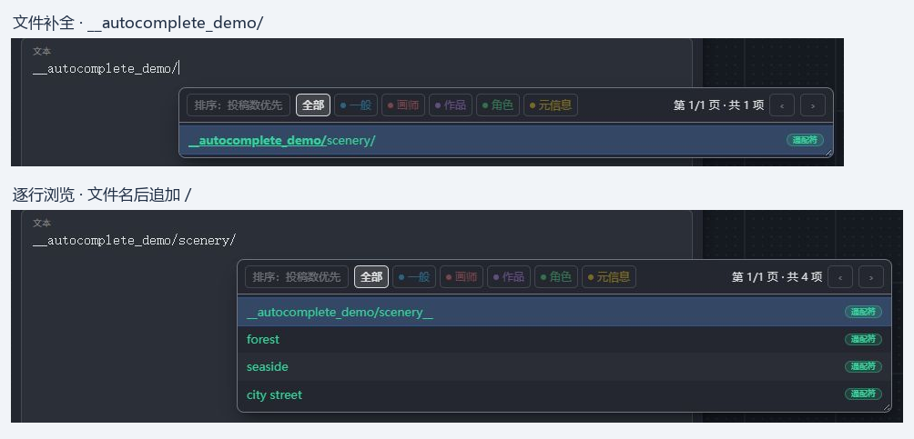

通配符使用 UTF-8 `.txt`，每行一个候选。支持本插件的 `wildcards/`、`ComfyUI/wildcards/` 及其他自定义节点的 `wildcards/`，也可以嵌套进动态表达式。

复现截图可将 [scenery.txt](docs/examples/scenery.txt) 放到 `ComfyUI/wildcards/autocomplete_demo/scenery.txt`。

### 展开模式与 PNG 恢复

全局设置和画布控制器都可选择展开模式。同一次生成中的多次处理会复用一致选择，便于分阶段处理或细节修复。

| 模式 | 行为 |
| --- | --- |
| 随机 | 每次生成重新抽取 |
| 跟随种子 | 按生成种子决定选择 |
| 保持上次选择 | 主种子不变时沿用上次选择 |
| 按顺序 | 依次使用文件行，仅适用于通配符 |

查看模式菜单和实验性 PNG 恢复入口

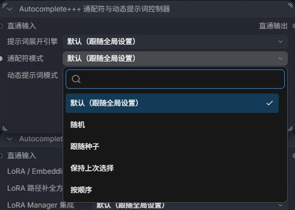

「导入 PNG 时恢复上次选择」为默认关闭的实验功能。在「保持上次选择」模式下，可从含所需元数据的 PNG 恢复动态选择及本地通配符选项，需要本地存在对应通配符。

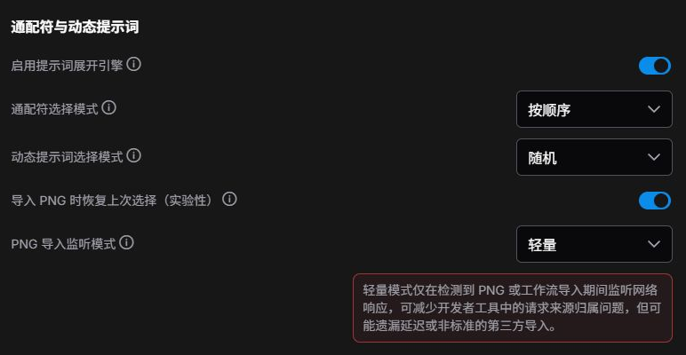

此图展示设置入口。普通 JSON 工作流、缺少所需元数据的 PNG 不支持恢复；恢复选择也不保证跨设备生成的图片完全一致。[适用条件与监听模式](README_zh.md#展开模式)。

### 提示词编辑与自动整理

`Ctrl + ↑ / ↓` 调整完整标签、Embedding 或 LoRA 的权重；`Ctrl + ← / →` 按标签移动，`Alt + ← / →` 交换相邻标签。

离开输入框时可自动整理逗号和空格、转换下划线，并保护模型、通配符等语法。花括号支持自动闭合、包裹选区、成对删除，以及跳过已有右括号。

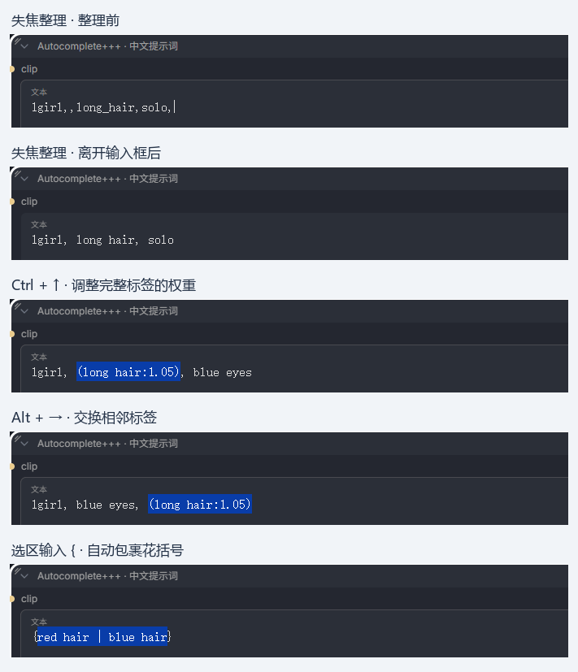

标签 / Embedding 与 LoRA 有独立权重步长；逗号、行末处理和下划线转换可分别开关，也可配置保留下划线的标签。[编辑与格式化规则](README_zh.md#提示词编辑与格式化)。

### 常用标签与个人记录

达到个人使用次数阈值后，候选会显示「常用」徽标。开启常用优先时，最多 3 个常用标签可置顶；它与词库投稿数排序是独立设置。

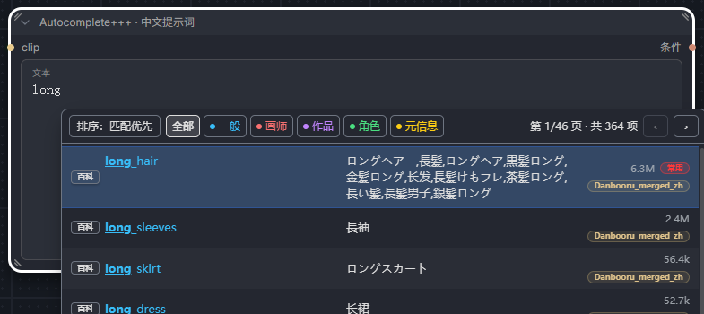

最少使用次数、有效期、历史容量和清除历史均可配置；有效期为 `0` 表示永不过期。备份个人记录时保留 `data/user_data.json`。

### 本地关联标签

点击提示词中的 Danbooru 标签，或按 `Ctrl + Shift + Space`，查看共现关系推荐。选择候选可插入到当前标签后，已有标签会灰显并支持定位。

下图从 `scenery` 打开关联面板，开启「插入后保持面板打开」后选择 `tree`；提示词已更新，`tree` 与原本存在的 `cloud` 均显示为灰色。

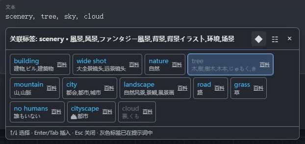

查看纵向列表与关联数据说明

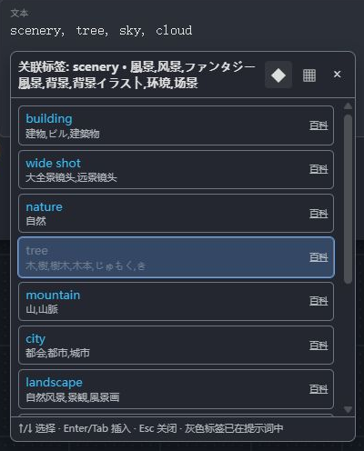

工具栏可切换横向 / 纵向布局。关联候选按本地共现数据计算的相似度排序，可配置 5–100 项，且限于当前加载的 Danbooru 词库。部分标签没有关联记录。

此功能需要本地关联索引；如果下载包未包含索引，可按[构建说明](docs/DICTIONARIES.md#关联索引构建)生成。

### 四种工作流控制器

四种控制器直接放在画布上即可为当前工作流覆盖设置，无须连线：

| 控制器 | 可覆盖的内容 |
| --- | --- |
| 通配符与动态提示词 | 展开开关、抽取模式 |
| 格式整理 | 逗号、下划线、括号、Anima 画师前缀 |
| 插件集成 | LoRA / Embedding、路径和 LoRA Manager |
| 词典 | 主词库、附加词库、翻译文件 |

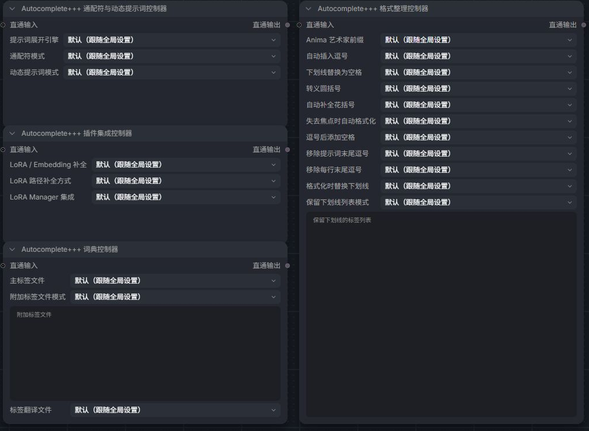

查看多个同类控制器的生效状态

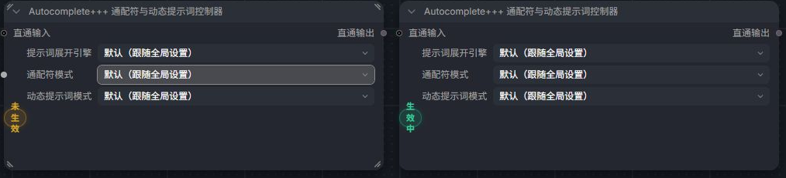

选择「默认（跟随全局设置）」即可继续使用全局值。同类控制器并存时，最后修改的优先；Node 2.0 会显示生效状态，点击未生效徽标可切换控制权。静音或绕过控制器会让出控制权。

控制器还提供可选直通端口，供工作流整理使用。[控制器与优先级](README_zh.md#工作流控制与节点菜单)。

### 节点菜单与画布兼容

经典画布的节点右键菜单提供 `Autocomplete+++` 子菜单，可以忽略某类节点、强制接管某类节点，或只对当前节点禁用补全。原生 Note 节点默认不启用补全。

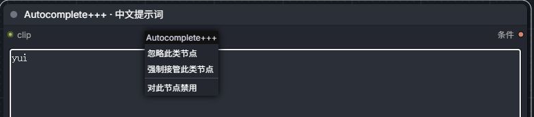

查看经典 LiteGraph 画布中的补全效果

插件支持经典 LiteGraph 与 Node 2.0 文本输入框。前文多数截图为 Node 2.0，下图为经典画布。

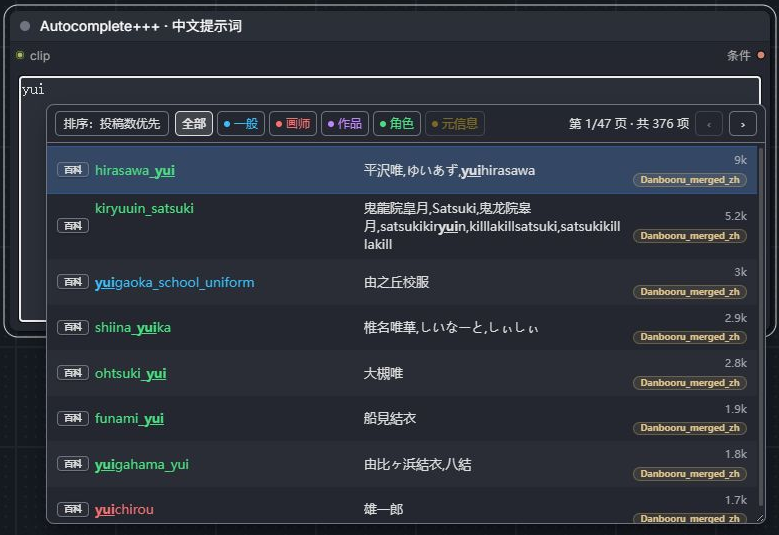

### 中文设置与词库组合

在 ComfyUI 设置中打开 `Autocomplete+++`，可分别选择主标签、附加词库和翻译文件，独立控制中文搜索与译名显示。支持 Danbooru、e621 和自定义 CSV。

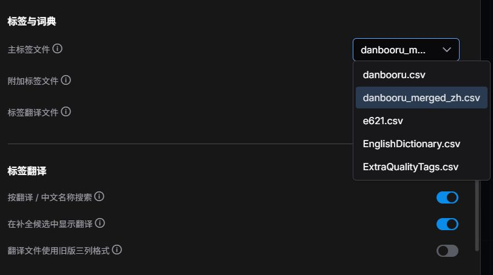

`danbooru_merged_zh.csv` 已内嵌译名，翻译文件可选「无」。额外选择 `danbooru_zh.csv` 等翻译文件时，其非空译名会覆盖内嵌译名；工作流中的词典控制器也可覆盖全局文件选择。

查看中文设置总览

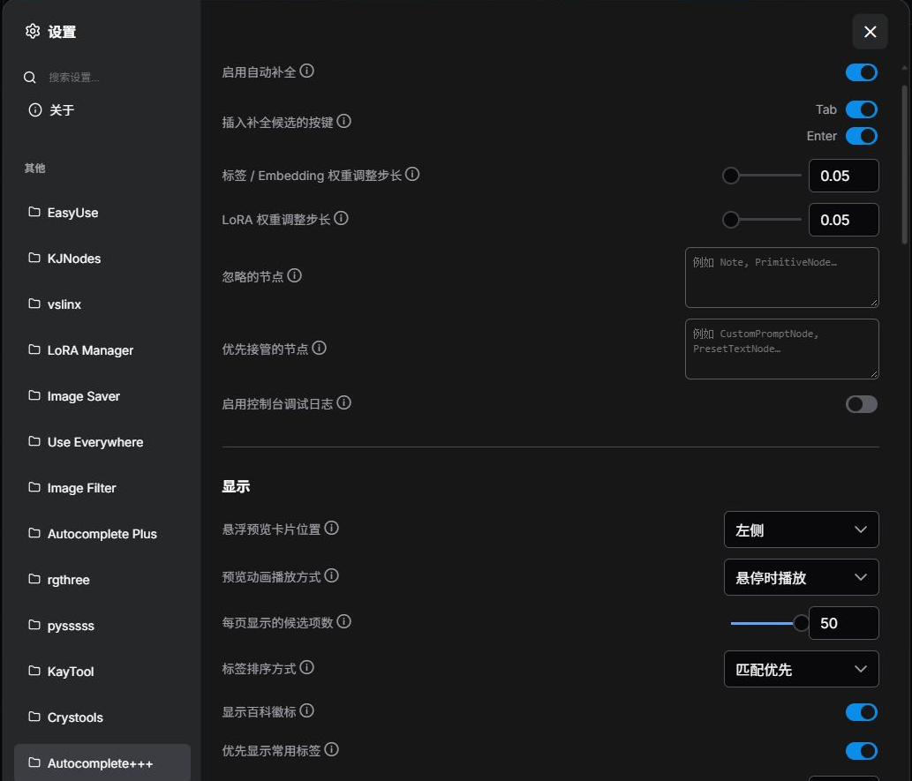

[完整设置速查](README_zh.md#设置速查) · [CSV 格式与编码](docs/DICTIONARIES.md)

### 工作流完成提示音

每个队列任务成功完成后提醒一次，包括全部使用缓存的任务；失败或手动中断不播放。支持清亮双音、柔和钟声、完成琶音和电子三连音，可调音量、独立开关并试听。

在「设置 → Autocomplete+++ → 工作流提醒」中调整，默认开启、音量为 35%。声音由浏览器本地合成；打开或刷新页面后，先点击页面或按键允许播放，并保持页面打开且未静音。[使用说明](README_zh.md#工作流完成提示音)。

## 常用快捷键

| 按键 | 操作 |
| --- | --- |
| `↑` / `↓` | 选择候选，可跨页 |
| `Enter` / `Tab` | 插入选中候选，受按键设置控制 |
| `PageUp` / `PageDown` | 上一页 / 下一页 |
| `F1` | 打开标签百科或 LoRA 详情 |
| `Ctrl + Shift + Space` | 打开关联标签 |
| `Ctrl + ↑` / `↓` | 调整权重 |
| `Ctrl + ←` / `→` | 按标签移动光标 |
| `Alt + ←` / `→` | 交换标签位置 |
| `Esc` | 关闭弹窗或面板 |

[完整快捷键与操作说明](README_zh.md#快捷键速查)

## 常见问题

界面还是英文，或词条没有中文？

将 ComfyUI 语言设为中文，重启后端并按 `Ctrl + F5`。词条译名还需要选择中文主词库，并开启翻译显示；界面语言与词库译名是两个独立设置。

为什么翻译文件选「无」仍然显示中文？

`danbooru_merged_zh.csv` 第五列已经包含译名。「无」表示不加载额外的覆盖翻译。可以分别关闭译名显示或中文搜索。

搜索结果多，或常见角色排得靠后？

尝试「角色」筛选和「投稿数优先」，再浏览后续页面。启用常用置顶时，最多 3 个个人常用标签仍可排在前面；需要比较纯排序时可关闭该设置。

缺少投稿数的数据以 `0` 参与排序。若词库选择没有生效，请检查工作流中的词典控制器。

关联面板没有结果，或出现重复补全弹窗？

关联面板需要本地索引和当前加载的 Danbooru 词库，其数据覆盖范围小于普通词库，部分标签没有共现记录。

重复弹窗通常来自多个补全扩展同时接管同一输入框，可在 ComfyUI 扩展管理中停用重复的补全前端。

## 文档与词库

- [完整使用指南](README_zh.md)：模型与触发词、Anima、动态语法、格式化、控制器和设置。
- [词库与关联索引](docs/DICTIONARIES.md)：CSV 格式、合并来源、翻译保留规则及索引构建。
- [发布说明](docs/PUBLISHING.md)：上传 GitHub 时的数据文件和项目元数据处理。

本项目 Danbooru 词库截止至 **2026.10.12**，使用当日的 tagdb-updater 来源快照，编码为 **UTF-8 无 BOM**。已有译名与别名原样保留，只有新增词条补充机器翻译；数据不自动更新，也未全部人工校订。

## 项目来源与致谢

本分支以 Autocomplete++ `1.3.0` 为改造基础。上游提供补全、动态展开、格式化与控制器，本分支增加中文界面和词库、双排序、完整分页、类别筛选、可调布局及本地关联标签。

| 项目 | 来源与贡献 |
| --- | --- |
| [michikora / Autocomplete++](https://github.com/michikora/ComfyUI-Autocomplete-Plus-Plus) | 本分支上游 |
| [newtextdoc1111 / Autocomplete-Plus](https://github.com/newtextdoc1111/ComfyUI-Autocomplete-Plus) | 原始补全项目、已有词库及关联标签参考 |
| [PYU224 / tagdb-updater](https://github.com/PYU224/tagdb-updater) | 标签、分类、投稿数和日文名称 |
| [boorutan / booru-japanese-tag](https://github.com/boorutan/booru-japanese-tag) | 上游数据使用的部分日文词库 |
| [DominikDoom / tagcomplete](https://github.com/DominikDoom/a1111-sd-webui-tagcomplete) | 上游功能的灵感与参考 |
| [ComfyUI](https://github.com/Comfy-Org/ComfyUI) | 运行平台 |

代码采用 [MIT License](LICENSE)，保留原作者版权声明。第三方词库、共现数据和图片按各自来源说明使用。
