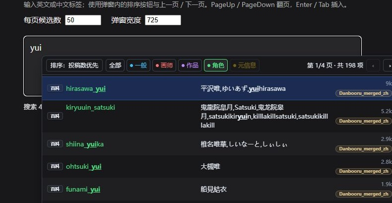

<div align="center">

# Autocomplete+++

**ComfyUI 中文提示词助手**

标签补全 · 模型与触发词 · 动态提示词 · 通配符 · 提示词编辑


[快速开始](#快速开始) · [功能介绍](#功能介绍) · [使用指南](README_zh.md) · [常见问题](#常见问题)

</div>

Autocomplete+++ 在 ComfyUI 的提示词输入框中提供标签搜索、中文名称、LoRA / Embedding 补全，以及提示词展开和编辑工具。支持经典 LiteGraph 与 Node 2.0。

项目基于 [Autocomplete++](https://github.com/michikora/ComfyUI-Autocomplete-Plus-Plus) 改造，在原有功能上加入中文 UI、双排序、完整分页、类别筛选、可调补全布局和本地关联标签。当前合并词库包含 **296,884 个去重标签**。

## 快速开始

### 安装

1. 下载本仓库 ZIP，将插件放入 `ComfyUI/custom_nodes/comfyui-autocomplete-plus-plus-plus/`。
2. 确认该目录下直接包含 `__init__.py`，重启 ComfyUI 后端，再按 `Ctrl + F5` 刷新浏览器。
3. 将 ComfyUI 语言设为中文，在设置中搜索 `Autocomplete+++`。

插件使用 ComfyUI 现有 Python 环境，没有额外声明的 Python 依赖。LoRA Manager 为可选集成。

<details>
<summary>从 Autocomplete++ 或已有安装升级</summary>

备份自定义词库、通配符和 `data/user_data.json`，再更新插件文件。原目录名为 `comfyui-autocomplete-plus-plus` 时，可改为 `comfyui-autocomplete-plus-plus-plus`。

仅保留一个生效版本，避免重复注册节点与接口。内部设置 ID、节点类型和本地 API 标识保持兼容，已有设置、常用记录及工作流可以继续使用。

ComfyUI-Manager 中的 `Autocomplete++` 条目对应原项目。安装本分支请使用本仓库文件；通过上游渠道更新前应备份本地修改。

</details>

### 启用中文词库

| 设置 | 推荐值 |
| --- | --- |
| 主标签文件 | `danbooru_merged_zh.csv` |
| 标签翻译文件 | `无`，使用主词库内嵌译名 |
| 按翻译 / 中文名称搜索 | 开启 |
| 在补全候选中显示翻译 | 开启 |

默认主词库仍为 `danbooru.csv`，请手动切换。工作流中若有「词典控制器」，将其设为跟随全局，或选择相同文件。

配置后可以输入 `long hair`、`长发` 或 `yui` 试用补全。选中候选后，按 `Enter` / `Tab` 插入对应英文标签。

## 功能介绍

### 标签补全与中文搜索

支持搜索 Danbooru / e621 标签、别名和译名。可以输入英文原名，也可以用中文查找；候选会显示标签类别、译名及投稿数。点击百科按钮或按 `F1` 可查阅标签 Wiki。

合并词库保留已有名称与别名，例如：

```text
hirasawa_yui → 平沢唯,ゆいあず,yuihirasawa
```

下面是输入 `yui` 后，筛选「角色」并使用「投稿数优先」的补全组件演示。



<details>
<summary>查看类别颜色</summary>

| 颜色 | 类别 | 常见内容 |
| --- | --- | --- |
| 蓝色 | 一般 | 发色、服装、动作、构图 |
| 红色 | 画师 | 画师、创作者 |
| 紫色 | 作品 | 动画、游戏、系列 |
| 绿色 | 角色 | 角色名称 |
| 黄色 | 元信息 | 图片和制作方式等元数据 |

这组含义对应 Danbooru。e621 还包含物种、设定和无效标签，详见[类别说明](README_zh.md#类别与颜色)。

</details>

### 排序、筛选与完整分页

弹窗顶部可切换两种排序：

- **匹配优先**：按原名、译名和别名的匹配程度排列，前缀匹配通常更靠前。
- **投稿数优先**：完全匹配优先，其余按词库投稿数降序排列，方便找到常见角色、作品和画师。

点击类别按钮可缩小范围，再点当前类别或「全部」取消筛选。每页可显示 5–50 项，使用翻页按钮、`PageUp` / `PageDown` 浏览全部匹配结果。

翻页和筛选复用当前结果，仅绘制当前页。补全窗口支持拖动调宽、自动换行，以及行内、左右分栏、上下排列三种布局。

### LoRA、Embedding 与触发词

输入 `<lora:` 选择 LoRA，输入 `embedding:` 或 `emb:` 选择 Embedding。支持子目录浏览、缩略图预览和路径补全。

安装 [ComfyUI-Lora-Manager](https://github.com/willmiao/ComfyUI-Lora-Manager) 后，还可用 `<trigger:` 查找当前工作流所加载 LoRA 的触发词，一次插入整组预设，并查看模型详情、推荐参数和图片生成信息。

<details>
<summary>查看触发词与模型详情效果图</summary>

以下截图来自 Autocomplete+++ 的实际中文界面，使用本地模型与 LoRA Manager 展示。

**触发词补全与整组预设**


**中文模型详情**


</details>

### 动态提示词与通配符

在提示词中写入备选项，生成时按所选模式展开：

```text
{red hair | blue hair | green hair}
```

也可以使用权重、多选组合，或从文本文件抽取内容：

```text
{3::sunny | 1::rainy}
{2$$red ribbons | blue ribbons | green hairband}
__backgrounds/scenery__
```

支持随机、跟随种子、保持上次选择；通配符另有顺序模式。同一次生成中的多次处理复用一致的选择。[查看语法与模式](README_zh.md#动态提示词与通配符)。

### 提示词编辑与自动整理

`Ctrl + ↑ / ↓` 调整完整标签、Embedding 或 LoRA 的权重；`Ctrl + ← / →` 按标签移动，`Alt + ← / →` 交换相邻标签。

离开输入框时可自动整理逗号和空格、转换下划线，并保护模型、通配符等语法。花括号支持自动闭合和包裹选区。

```text
整理前：1girl,,long_hair,solo,
整理后：1girl, long hair, solo
```

常用标签会记录使用次数，达到阈值后可优先显示。阈值、有效期、容量和清除操作均可在设置中调整。

### 本地关联标签

点击提示词中的 Danbooru 标签，或按 `Ctrl + Shift + Space`，查看共现关系推荐。选择候选可插入到当前标签后，已有标签会灰显并支持定位。

面板支持横向 / 纵向布局和连续插入。此功能使用本地关联索引；如果下载包未包含索引，可按[构建说明](docs/DICTIONARIES.md#关联索引构建)生成。

### 工作流控制与节点兼容

四种控制器直接放在画布上即可为当前工作流覆盖设置，无须连线：

| 控制器 | 可覆盖的内容 |
| --- | --- |
| 通配符与动态提示词 | 展开开关、抽取模式 |
| 格式整理 | 逗号、下划线、括号、Anima 画师前缀 |
| 插件集成 | LoRA / Embedding、路径和 LoRA Manager |
| 词典 | 主词库、附加词库、翻译文件 |

节点右键菜单还可单独启用或禁用补全，以及按节点类型忽略或强制接管。原生 Note 节点默认不启用补全。

## 常用快捷键

| 按键 | 操作 |
| --- | --- |
| `↑` / `↓` | 选择候选，可跨页 |
| `Enter` / `Tab` | 插入选中候选，受按键设置控制 |
| `PageUp` / `PageDown` | 上一页 / 下一页 |
| `F1` | 打开标签百科或 LoRA 详情 |
| `Ctrl + Shift + Space` | 打开关联标签 |
| `Ctrl + ↑` / `↓` | 调整权重 |
| `Ctrl + ←` / `→` | 按标签移动光标 |
| `Alt + ←` / `→` | 交换标签位置 |
| `Esc` | 关闭弹窗或面板 |

[完整快捷键与操作说明](README_zh.md#快捷键速查)

## 常见问题

<details>
<summary>界面还是英文，或词条没有中文？</summary>

将 ComfyUI 语言设为中文，重启后端并按 `Ctrl + F5`。词条译名还需要选择中文主词库，并开启翻译显示；界面语言与词库译名是两个独立设置。

</details>

<details>
<summary>为什么翻译文件选「无」仍然显示中文？</summary>

`danbooru_merged_zh.csv` 第五列已经包含译名。「无」表示不加载额外的覆盖翻译。可以分别关闭译名显示或中文搜索。

</details>

<details>
<summary>搜索结果多，或常见角色排得靠后？</summary>

尝试「角色」筛选和「投稿数优先」，再浏览后续页面。启用常用置顶时，最多 3 个个人常用标签仍可排在前面；需要比较纯排序时可关闭该设置。

缺少投稿数的数据以 `0` 参与排序。若词库选择没有生效，请检查工作流中的词典控制器。

</details>

<details>
<summary>关联面板没有结果，或出现重复补全弹窗？</summary>

关联面板需要本地索引和当前加载的 Danbooru 词库，其数据覆盖范围小于普通词库，部分标签没有共现记录。

重复弹窗通常来自多个补全扩展同时接管同一输入框，可在 ComfyUI 扩展管理中停用重复的补全前端。

</details>

## 文档与词库

- [完整使用指南](README_zh.md)：模型与触发词、Anima、动态语法、格式化、控制器和设置。
- [词库与关联索引](docs/DICTIONARIES.md)：CSV 格式、合并来源、翻译保留规则及索引构建。
- [发布说明](docs/PUBLISHING.md)：上传 GitHub 时的数据文件和项目元数据处理。

当前词库使用 **UTF-8 无 BOM**，tagdb-updater 来源快照日期为 **2026-10-12**。已有译名与别名原样保留，只有新增词条补充机器翻译；数据不自动更新，也未全部人工校订。

## 项目来源与致谢

本分支以 Autocomplete++ `1.3.0` 为改造基础。上游提供补全、动态展开、格式化与控制器，本分支增加中文界面和词库、双排序、完整分页、类别筛选、可调布局及本地关联标签。

| 项目 | 来源与贡献 |
| --- | --- |
| [michikora / Autocomplete++](https://github.com/michikora/ComfyUI-Autocomplete-Plus-Plus) | 本分支上游 |
| [newtextdoc1111 / Autocomplete-Plus](https://github.com/newtextdoc1111/ComfyUI-Autocomplete-Plus) | 原始补全项目、已有词库及关联标签参考 |
| [PYU224 / tagdb-updater](https://github.com/PYU224/tagdb-updater) | 标签、分类、投稿数和日文名称 |
| [boorutan / booru-japanese-tag](https://github.com/boorutan/booru-japanese-tag) | 上游数据使用的部分日文词库 |
| [DominikDoom / tagcomplete](https://github.com/DominikDoom/a1111-sd-webui-tagcomplete) | 上游功能的灵感与参考 |
| [ComfyUI](https://github.com/Comfy-Org/ComfyUI) | 运行平台 |

代码采用 [MIT License](LICENSE)，保留原作者版权声明。第三方词库、共现数据和图片按各自来源说明使用。
