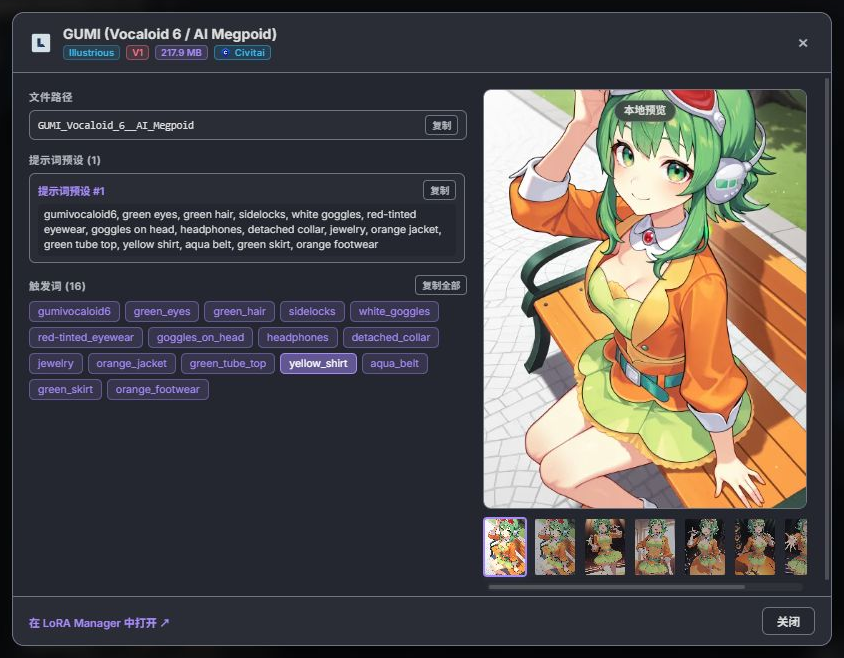

# Autocomplete+++ 使用指南

[项目首页](README.md) · [词库与索引](docs/DICTIONARIES.md) · [发布说明](docs/PUBLISHING.md)

本指南将上游 Autocomplete++ 的功能、语法、快捷键和设置说明译为中文，并结合 Autocomplete+++ 的交互与词库整理。初次安装请先完成[快速配置](README.md#快速开始)。默认主词库为 `danbooru_merged_zh.csv`，Danbooru 词库截止至 **2026.10.12**。

各项功能的实际中文界面、排序与布局对比、动态提示词运行结果，见首页的[功能图解](README.md#功能介绍)。

**按需跳转：** [标签搜索](#标签搜索) · [模型与触发词](#模型与触发词) · [动态语法](#动态提示词与通配符) · [提示词编辑](#提示词编辑与格式化) · [工作流控制](#工作流控制与节点菜单) · [设置](#设置速查)

## 标签搜索

在提示词输入框键入英文标签、别名或中文名称即可搜索，选择后按 `Enter` / `Tab` 插入。插入的仍是对应英文标签，下划线、括号和逗号按格式化设置处理。

中文界面跟随 ComfyUI 语言；中文搜索与译名显示由词库及对应设置控制，可以独立开关。选择独立翻译文件时，其中的非空译名会覆盖主词库内嵌译名。

### 限定搜索范围

普通搜索可直接用弹窗顶部的类别按钮，也可以在输入内容中指定类别或词库：

```text
/character yui
/artist artist_name
/danbooru /artist artist_name
/danbooru artist artist_name
```

支持 `/general`、`/artist`、`/copyright`、`/character`、`/meta`，以及 `/danbooru`、`/e621`。可以组合词库与类别条件。

点击百科徽标或选中候选后按 `F1`，可打开对应 Wiki。自动识别来源时，词库文件名需包含 `danbooru` 或 `e621`。

### 排序与分页

| 模式 | 规则 |
| --- | --- |
| 匹配优先 | 综合原名、译名、别名的完全、前缀、词边界和包含匹配评分 |
| 投稿数优先 | 原名 / 译名或别名的完全匹配先排，其余按投稿数降序，再比较匹配评分 |

「优先显示常用标签」是另一项设置，开启后最多置顶 3 个个人常用标签。投稿数来自 CSV 快照，缺少元数据的词条通常为 `0`。

每页候选数量默认为 15，可设为 5–50。翻页按钮和 `PageUp` / `PageDown` 切换整页；上下方向键可跨页。所有匹配项保留在当前结果集中，单页上限不会截断总结果。

输入新查询或切换类别后回到第一页。翻页、排序、筛选复用当前结果，不重新读 CSV 或重做全词库搜索；新查询的耗时仍取决于数据量与设备。

### 类别与颜色

| Danbooru 编号 | 类别 | 颜色 |
| --- | --- | --- |
| `0` | 一般 | 蓝色 |
| `1` | 画师 | 红色 |
| `3` | 作品 | 紫色 |
| `4` | 角色 | 绿色 |
| `5` | 元信息 | 黄色 |

类别按钮兼作图例。一次选择一个类别，再点当前类别或「全部」取消筛选；无匹配项的按钮置灰。选择在输入期间保留，关闭弹窗后恢复「全部」。

<details>
<summary>e621 与特殊候选的分类</summary>

e621 使用独立编号：`5` 为物种、`6` 为无效、`7` 为元信息、`8` 为设定；其 `0 / 1 / 3 / 4` 分别为一般、画师、作品、角色。

LoRA、Embedding、通配符和触发词使用各自候选类型，其颜色不能解释为 Danbooru 的角色或作品。

</details>

### 调整弹窗布局

普通补全窗口默认宽 520 px，可在 280–1600 px 间调整，实际不超出可用视口。拖动右下角可以保存宽度。

标签与译名可行内显示、左右分栏或上下排列。自动换行默认开启；关闭后，被截断的词条可通过悬停查看。设置页提供实际宽度的布局预览。

## 模型与触发词

### LoRA 与 Embedding

| 输入前缀 | 用途 |
| --- | --- |
| `<lora:` | 搜索本地 LoRA，浏览子目录和预览缩略图 |
| `embedding:` / `emb:` | 搜索 Textual Inversion / Embedding |
| `<trigger:` | 搜索当前工作流已加载 LoRA 的触发词，需要 LoRA Manager |

LoRA 路径补全有三种模式：

- 自动：通常插入文件名；子目录中存在重名文件时改用相对路径，并兼顾可用的 LoRA Manager 路径设置。
- 仅文件名：插入简洁名称。
- 完整路径：插入相对模型目录的完整路径。

预览卡片可以显示在左侧、右侧或关闭；视频缩略图的播放方式也可在显示设置中调整。

### LoRA Manager 集成

安装并启用 [ComfyUI-Lora-Manager](https://github.com/willmiao/ComfyUI-Lora-Manager) 后，`<trigger:` 会列出当前工作流 LoRA 的触发词。悬停或选择候选可查看预览和组合提示词预设，点击「插入整组」即可使用完整预设。

选中触发词后按 `F1` 或点击信息按钮，可打开模型详情。多个 LoRA 共用同一触发词时，会先出现模型选择菜单。

详情视图可提供：

- 文件名、路径、基础模型、版本、大小，以及 Civitai / Hugging Face 链接。
- 已配置或缓存的推荐强度、CLIP 参数、模型说明和个人备注。
- 触发词与组合预设的单项复制、整组复制。
- 本地预览及展示图；点击图片查看可用的提示词、负面提示词、采样器、种子、步数和 CFG 等生成信息。

内容取决于 LoRA Manager 版本及其提供的数据。详情页底部可直接跳转到 LoRA Manager 中的模型位置。

<details>
<summary>模型详情视图示例</summary>

下图为 Autocomplete+++ 的实际中文模型详情页，包含提示词预设、触发词复制和模型图库。



</details>

### Anima 画师语法

使用 Anima 时，可输入 `@` 搜索画师。Anima 模式生效后，从普通搜索选择画师标签也会自动添加 `@`。

```text
masterpiece, 1girl, @artist_name1, @artist_name2
```

默认自动检测模型，也可在「Anima 艺术家前缀」设置中强制启用或关闭。

## 动态提示词与通配符

展开引擎在生成前解析选择表达式和通配符。可在全局设置或工作流控制器中启用、关闭和选择模式。

### 随机选择与权重

从多个选项中选择一个：

```text
{red hair | blue hair | green hair}
```

通过 `数字::内容` 设置权重。下例中晴天与雨天的抽取概率为 3:1：

```text
{3::sunny, outdoors | 1::rainy, indoors}
```

### 多项组合与分隔符

抽取 2 个不同选项，默认用逗号连接：

```text
{2$$red ribbons | blue ribbons | green hairband}
```

抽取 1–3 个选项，并使用 ` and ` 连接：

```text
{1-3$$ and $$apples | bananas | oranges}
```

### 通配符文件

通配符使用 UTF-8 `.txt` 文件，每行一个候选。例如 `wildcards/backgrounds/scenery.txt` 可以写成：

```text
forest
seaside
city street
```

在提示词中输入下列内容，生成时抽取其中一行：

```text
__backgrounds/scenery__
```

输入 `__` 可浏览文件与目录。输入文件路径后追加 `/`，例如 `__backgrounds/scenery/`，可直接浏览并选取文件内的单行内容。通配符可嵌套在动态选择中。

支持的文件位置：

- 本插件的 `wildcards/`。
- `ComfyUI/wildcards/`。
- 其他自定义节点的 `wildcards/`，即 `ComfyUI/custom_nodes/*/wildcards/`。

### 展开模式

| 模式 | 适用范围 | 行为 |
| --- | --- | --- |
| 随机 | 动态提示词、通配符 | 每次生成重新抽取 |
| 跟随种子 | 动态提示词、通配符 | 按生成种子决定选择 |
| 保持上次选择 | 动态提示词、通配符 | 主种子不变时沿用上次生成的选择 |
| 按顺序 | 通配符 | 在连续生成中依次取用文件行 |

同一次生成中的多次处理会复用一致的选择，适用于分阶段处理和细节修复。主种子不变时，「保持上次选择」可用于固定已选组合，再微调其他提示词。

使用 `\{`、`\}`、`\__` 输出字面量。没有选择语法的花括号和 JSON 结构会保留。

<details>
<summary>实验功能：从 PNG 恢复上次选择</summary>

「导入 PNG 时恢复选择」默认关闭。启用后，在「保持上次选择」模式下导入包含相应提示词元数据的 PNG，可恢复其中的动态选择与本地通配符选项；主种子不变时继续沿用。

该功能需要本地存在对应通配符。普通 JSON 工作流和没有所需元数据的 PNG 不支持恢复；恢复选项也不保证不同设备间生成的图片完全一致。

导入观察模式 `Lite` 仅在导入期间观察浏览器请求，`Full` 持续观察以兼容更多第三方导入方式。观察期间，开发者工具可能将其他请求的调用来源显示为本插件包装器；请求内容和常规行为不作修改。关闭恢复功能后解除观察。

</details>

## 提示词编辑与格式化

### 权重、移动与换位

`Ctrl + ↑ / ↓` 按完整标签或当前选区调整权重：

```text
long hair → (long hair:1.05)
(embedding:easynegative:1.05)
<lora:anime_style_v2:0.8>
```

支持普通标签、已有括号权重、`embedding:` / `emb:`，以及 `<lora:...>`、`<lyco:...>` 和简写模型权重。权重回到 `1.0` 时会移除普通标签的外层权重括号。

标签 / Embedding 与 LoRA 有独立步长，默认 `0.05`，可设为 `0.05–0.50`。

`Ctrl + ← / →` 按完整标签移动光标，也可在动态表达式中按选项移动。`Alt + ← / →` 交换相邻标签；模型、通配符和动态表达式可作为整体处理，动态选择内部的交换限制在选项范围内。

### 花括号与失焦整理

开启自动闭合后，输入 `{` 会补上 `}`；选中文字再输入 `{` 可包裹选区。空的 `{}` 中按退格会一起删除，遇到已存在的右括号时可直接跳过。

开启失焦格式化后，离开输入框会按规则整理：

```text
1girl,,long_hair,solo, → 1girl, long hair, solo
```

可以分别控制逗号后的空格、提示词末尾逗号、行末逗号和下划线转换。表情符号、LoRA / Embedding 和通配符语法会保留；动态选择中的普通标签也会整理。

需要保留下划线的自定义标签，可加入「保留下划线的标签」列表。

### 常用标签

插件按个人使用次数记录常用标签，达到阈值后显示常用徽标并可置顶，最多 3 项。

设置中可调整最少使用次数、有效天数和记录容量，也可清除历史。有效期设为 `0` 表示永不过期。备份个人配置时保留 `data/user_data.json`。

## 工作流控制与节点菜单

### 四种画布控制器

在 `Autocomplete+++` 节点分类下添加控制器，放置后即可覆盖当前工作流的对应设置。选择「跟随全局设置」的选项继续使用全局值。

| 控制器 | 覆盖内容 |
| --- | --- |
| 通配符与动态提示词 | 展开引擎、通配符模式、动态提示词模式 |
| 格式整理 | Anima 前缀、逗号、下划线、括号、自动闭合、失焦规则及下划线保留列表 |
| 插件集成 | LoRA / Embedding 提示、路径模式和 LoRA Manager 集成 |
| 词典 | 主词库、附加词库及翻译文件，包含 CSV 文件选择器 |

控制器无需连线。可选的直通输入 / 输出能够原样传递 MODEL、CLIP、IMAGE、PIPE 等数据，用于整理工作流。

<details>
<summary>同类控制器的优先级与状态</summary>

静音（`Ctrl + M`）或绕过（`Ctrl + B`）的控制器让出控制权。同类有效控制器并存时，最后修改设置的优先；没有交互记录时，节点 ID 较新的优先。

Node 2.0 中存在多个同类控制器时，会显示生效 / 未生效徽标。点击未生效徽标可切换控制权；只有一个同类控制器时不显示徽标。

经典界面使用相同仲裁逻辑，但不显示这组状态徽标。

</details>

### 节点右键菜单

在经典 LiteGraph 画布中，对支持文本的节点右键，打开 `Autocomplete+++` 子菜单：

- 为当前节点实例启用、禁用补全，或恢复默认。
- 按节点类型加入 / 移出全局忽略列表。
- 按节点类型强制接管 / 取消接管，处理其他内置弹窗冲突。

原生 Note 节点默认忽略，可通过实例菜单单独启用。

## 关联标签面板

点击单个 Danbooru 标签，或将光标放在标签中按 `Ctrl + Shift + Space` 打开。也可以把鼠标触发方式改为 `Ctrl + 点击` 或仅快捷键。

支持空格 / 下划线拼写和 `(long hair:1.2)` 等加权标签。模型、通配符、动态表达式不作为普通标签触发。

点击候选或使用方向键后按 `Enter` / `Tab`，会插入到当前标签后方；灰色候选表示已存在，点击可定位原位置。工具栏可切换横向 / 纵向布局，选择插入后保持打开，或关闭面板。

关联候选按共现数据计算的 Jaccard 相似度排序，限于当前加载的 Danbooru 词库。默认显示 30 项，可设为 5–100。

此功能需要 `data/danbooru_related.sqlite3`。当前索引约 83 MiB，覆盖 31,060 个标签；普通补全词库覆盖更广，部分词条没有关联记录。[构建或更新索引](docs/DICTIONARIES.md#关联索引构建)。

## 快捷键速查

### 补全与编辑

| 按键 | 场景 | 操作 |
| --- | --- | --- |
| `↑` / `↓` | 补全弹窗 | 移动选中项，可跨页 |
| `Enter` / `Tab` | 补全弹窗 | 插入候选，受插入按键设置控制 |
| `PageUp` / `PageDown` | 普通补全弹窗 | 上一页 / 下一页 |
| `Esc` / `←` / `→` | 普通补全弹窗 | 关闭候选弹窗 |
| `F1` | 标签或触发词候选 | 打开 Wiki 或 LoRA 详情 |
| `Ctrl + ↑` / `↓` | 提示词输入框 | 调整标签、Embedding 或 LoRA 权重 |
| `Ctrl + ←` / `→` | 提示词输入框 | 按标签移动光标 |
| `Alt + ←` / `→` | 提示词输入框 | 与相邻标签换位 |
| `Ctrl + Shift + Space` | 光标位于标签内 | 打开关联标签 |

### 模型详情与关联面板

| 按键 | 场景 | 操作 |
| --- | --- | --- |
| `1`–`9` | 触发词的 LoRA 选择菜单 | 打开对应模型的本地详情 |
| `Ctrl + 1`–`9` | 同上 | 打开对应 Civitai / Hugging Face 页面 |
| `←` / `→` | LoRA 详情 | 浏览展示图 |
| `Esc` | 详情或图片信息层 | 关闭当前层 |
| `↑` / `↓`、`Enter` / `Tab` | 关联面板 | 选择并插入标签 |
| `Esc` | 关联面板 | 关闭面板 |

## 设置速查

在 ComfyUI 设置中搜索 `Autocomplete+++`，按组调整：

| 分组 | 常用选项 |
| --- | --- |
| 自动补全 | 总开关、插入按键、节点忽略 / 接管、两种权重步长、调试日志 |
| 显示 | 排序、每页数量、弹窗宽度与布局、预览位置 / 播放、百科徽标、常用记录 |
| 格式整理 | Anima 前缀、逗号、下划线、括号、自动闭合、失焦整理 |
| 模型与插件集成 | LoRA / Embedding 开关、路径模式、LoRA Manager |
| 快捷键与交互 | 增强快捷键总开关，权重调整、光标移动、标签换位的独立开关 |
| 标签与词典 | 主词库、附加词库、翻译文件 |
| 标签翻译 | 中文搜索、译名显示、旧版三列翻译兼容 |
| 通配符与动态提示词 | 展开开关、两类模式、PNG 恢复与导入观察模式 |
| 关联标签 | 开关、触发方式、数量、默认布局 |

<details>
<summary>中文词库与自定义文件</summary>

主词库和附加 CSV 放入 `tags/`，独立翻译放入 `tags/translations/`。默认中文合并主词库为 `danbooru_merged_zh.csv`，已内嵌译名；独立翻译可选 `danbooru_zh.csv`。

使用本项目两列翻译时，关闭「旧版三列翻译格式」。新增或更换文件后，必要时重启后端并刷新页面以更新列表和缓存；同时检查工作流词典控制器是否覆盖全局选择。

具体列定义、编码和翻译优先级见[词库文档](docs/DICTIONARIES.md)。

</details>
